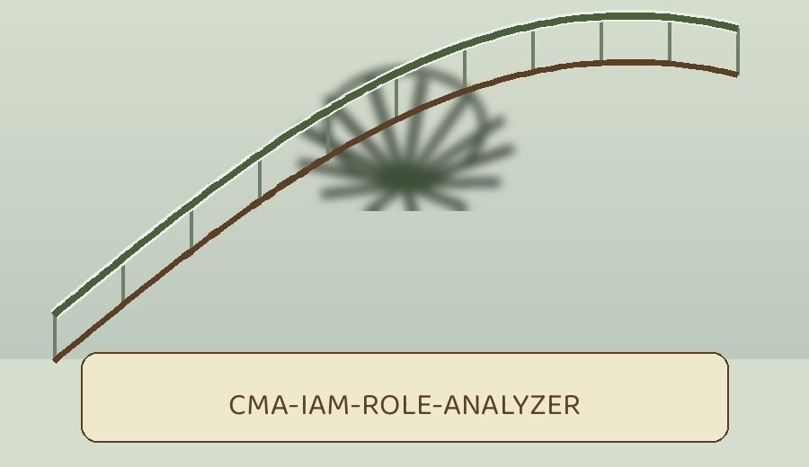
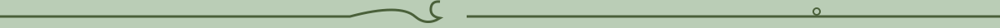
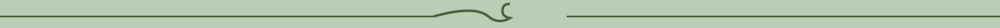

# cma-IAM-Role-Analyzer

Analyzes IAM roles in AWS to identify potential privilege escalation paths. Uses boto3 with the operator's own AWS profile to run three statement checks (wildcard actions, wildcard resources, and sts:AssumeRole) over the attached managed policies and the inline policies of a single named role, and reports the risky statements found. AWS only. If a role lookup fails, the run reports the error and exits 1 instead of returning an empty result.

> **Potting bench notice: what a clean run does not prove.** A run that finds nothing means none of the three checks matched. Only Allow statements are examined, conditions are never read, and the tests are exact matches, so it does not mean that no privilege escalation path exists.

## Install
`git clone https://github.com/ShadowStrikeHQ/cma-iam-role-analyzer`

> **Potting bench notice: clone line flagged.** The install line above points to ShadowStrikeHQ, not to ShadowGuard-AI. It is preserved as printed and flagged here, not quietly corrected.

## Usage
`./cma-iam-role-analyzer [params]`

> **Potting bench notice: usage line flagged.** The usage line above is a placeholder. The parser in main.py requires --role-name and offers --profile, --region, and --output-file.

## Parameters
- `-h`: Show help message and exit
- `--role-name`: The name of the IAM role to analyze.
- `--profile`: AWS CLI profile to use for authentication.
- `--region`: AWS region to use. Defaults to configured region or us-east-1.
- `--output-file`: No description provided

## License
Copyright (c) ShadowStrikeHQ

> **Potting bench notice: copyright line flagged.** The closing line above reads Copyright (c) ShadowStrikeHQ, preserved as printed. The repository LICENSE file carries the MIT License.
