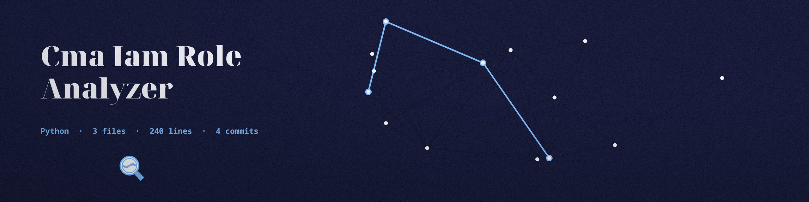

# cma-IAM-Role-Analyzer
Analyzes IAM roles in AWS to identify potential privilege escalation paths. Uses boto3 with the operator's own AWS profile to run three statement checks (wildcard actions, wildcard resources, and sts:AssumeRole) over the attached managed policies and the inline policies of a single named role, and reports the risky statements found. AWS only. If a role lookup fails, the run reports the error and exits 1 instead of returning an empty result.

## Install
`git clone https://github.com/ShadowStrikeHQ/cma-iam-role-analyzer`

## Usage
`./cma-iam-role-analyzer [params]`

## Parameters
- `-h`: Show help message and exit
- `--role-name`: The name of the IAM role to analyze.
- `--profile`: AWS CLI profile to use for authentication.
- `--region`: AWS region to use. Defaults to configured region or us-east-1.
- `--output-file`: No description provided

## License
Copyright (c) ShadowStrikeHQ
